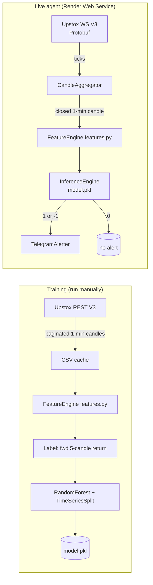

# F&O AI Trading Alert Agent — Design

## 1. Architecture Overview

The system is a single-process Python application with two concurrent loops:

1. **A background daemon thread** runs the Upstox Market Data WebSocket client. It aggregates ticks into 1-minute candles, recomputes features on each candle close, runs model inference, and dispatches Telegram alerts.
2. **The main thread** runs a minimal Flask app via gunicorn, exposing a `/health` endpoint so Render keeps the Web Service alive.

A third concern — **model training** — is a standalone CLI script (`train_model.py`) run offline (locally or as a one-off job), producing `model.pkl` that the live agent loads at startup.

```
┌─────────────────────────────────────────────────────────────────────┐
│                         Single Process (gunicorn)                     │
│                                                                       │
│  ┌────────────────────────┐        ┌───────────────────────────────┐ │
│  │  Background thread       │        │  Main thread (gunicorn WSGI)  │ │
│  │  LiveStreamEngine        │        │  Flask app (/health)          │ │
│  │  - WebSocket client      │        │                               │ │
│  │  - CandleAggregator      │        │  GET /health -> 200           │ │
│  │  - FeatureEngine (shared)│        │                               │ │
│  │  - InferenceEngine       │        └───────────────────────────────┘ │
│  │  - TelegramAlerter       │                                        │
│  └────────────┬─────────────┘                                        │
│               │ shares config + features module + model.pkl           │
└───────────────┼──────────────────────────────────────────────────────┘
                │
   Offline:  train_model.py  ->  model.pkl  ->  loaded at startup

External services:
  - Upstox REST  (historical candles, OAuth)
  - Upstox WS    (live market data feed, Protobuf)
  - Telegram Bot API (alerts)
  - Render       (hosting, $PORT, env vars)
```

### Data Flow



## 2. Module Design

### 2.1 `config.py` — Central configuration
- Loads all environment variables (see requirements §6) with typed defaults and validation.
- Validates that required secrets (`UPSTOX_ACCESS_TOKEN`, `TELEGRAM_BOT_TOKEN`, `TELEGRAM_CHAT_ID`) are present at live-agent startup; raises a clear error listing what is missing.
- Exposes a single `Config` dataclass / object imported by all modules.
- Defines feature configuration constants (indicator periods, label horizon, threshold) in one place so training and live stay synchronized.

### 2.2 `auth.py` — Optional OAuth helper
- Implements the Upstox authorization-code exchange: given an auth code (from the manual login URL), calls the token endpoint with `UPSTOX_API_KEY` / `UPSTOX_API_SECRET` to obtain an access token.
- Prints/returns the token for the operator to set as `UPSTOX_ACCESS_TOKEN`.
- The live agent does **not** depend on this module at runtime; it reads `UPSTOX_ACCESS_TOKEN` directly.

### 2.3 `data_fetcher.py` — Historical data download
- `fetch_historical_candles(instrument_key, from_date, to_date) -> pd.DataFrame`
- Calls `GET /v3/historical-candle/{instrument_key}/minutes/1/{to_date}/{from_date}` with `Authorization: Bearer <token>`.
- Paginates monthly because 1-minute data is capped at 1 month per request. Iterates month-by-month from `from_date` to `to_date`, sleeping between calls to respect rate limits.
- Normalizes the Upstox candle array `[timestamp, open, high, low, close, volume, open_interest]` into a typed DataFrame with a UTC/IST-aware datetime index.
- Persists to / reads from `data/historical_1min.csv`, appending only date ranges not already cached.
- Handles HTTP errors, 429 rate limits (backoff), and 401 (token expiry) distinctly.

### 2.4 `features.py` — Shared feature engineering (CRITICAL)
- Single source of truth for features, imported by both `train_model.py` and the live engine.
- `compute_features(df: pd.DataFrame) -> pd.DataFrame` takes a DataFrame with columns `['open','high','low','close','volume']` (datetime index) and returns a DataFrame with engineered columns:
  - `rsi_14` — RSI (14)
  - `macd`, `macd_signal`, `macd_hist` — MACD (12, 26, 9)
  - `bb_upper`, `bb_middle`, `bb_lower`, `bb_width` — Bollinger Bands (20, 2)
  - `ema_9`, `ema_21`, `ema_50` — EMA(9/21/50)
  - `atr_14` — ATR (14)
  - `return_1`, `return_5` — simple 1- and 5-candle log returns
- Uses `ta-lib` (`talib.RSI`, `talib.MACD`, `talib.BBANDS`, `talib.EMA`, `talib.ATR`).
- `FEATURE_COLUMNS` constant lists the exact ordered feature names the model expects — saved into `model.pkl` and reused at inference.
- NaN warm-up rows are dropped by the caller, not inside `compute_features` (so the caller controls the boundary).

### 2.5 `label.py` — Target construction (training only)
- `make_labels(df: pd.DataFrame, horizon=5, threshold=None) -> pd.Series`
- Computes forward return over `horizon` candles: `(close.shift(-horizon) - close) / close`.
- If `threshold` is None, uses an ATR-scaled default (`0.5 * atr / close`) so the threshold adapts to volatility.
- Returns `1` / `-1` / `0` per the rule in FR-2.6. The last `horizon` rows (which have no forward target) are dropped by the caller.

### 2.6 `model_trainer.py` — Training logic
- `train(df: pd.DataFrame) -> dict` orchestrating: feature compute → label → split → fit → evaluate → bundle.
- Uses `sklearn.ensemble.RandomForestClassifier` (n_estimators, max_depth, class_weight='balanced' to handle Hold-class imbalance).
- Cross-validates with `sklearn.model_selection.TimeSeriesSplit` (e.g., n_splits=5). Prints per-fold accuracy + a final classification report on the last fold.
- Produces the bundle `{"model": rf, "feature_columns": FEATURE_COLUMNS, "config": {...}}` and saves via `joblib.dump` to `model.pkl`.
- **Explicitly avoids** `train_test_split` / shuffled CV to prevent data leakage.

### 2.7 `train_model.py` — CLI entry point
- Parses args: `--instrument`, `--from`, `--to`, `--output` (default `model.pkl`).
- Calls `data_fetcher.fetch_historical_candles`, then `model_trainer.train`, then writes `model.pkl`.
- Prints a summary: rows fetched, feature count, CV accuracy per fold, feature importances (top 10).

### 2.8 `protobuf` — Market data decoding
- The Upstox V3 feed sends binary Protobuf messages. We include the Upstox `market_data_v3.proto` and compile it to `market_data_pb2.py` (committed to the repo), imported by the WebSocket client.
- A `decode_feed(raw_bytes) -> dict` helper wraps Protobuf parsing, returning a normalized dict with at least `ltp` (last traded price), `ltt` (last traded time), `ltq` (last traded qty), `cp` (close price), keyed by instrument.

### 2.9 `candle_aggregator.py` — Tick → candle aggregation
- Maintains the in-progress candle for the current minute and a rolling buffer of the last 1,000 closed candles.
- `on_tick(tick)`:
  - Determine the minute bucket (truncate tick time to minute, IST).
  - If no current candle, start one with this tick (open=high=low=ltp, volume=ltq).
  - If tick minute == current candle minute: update high/low/close, accumulate volume.
  - If tick minute > current candle minute: **close** the current candle, append to the rolling DataFrame, start a new candle from this tick.
- Returns a closed-candle event (with the closed candle + the updated DataFrame) so the caller can run inference.
- Thread-safe (called only from the WS thread, but uses a lock defensively).

### 2.10 `websocket_client.py` — Live market data feed
- Connects to the Upstox V3 WebSocket:
  1. (If needed) obtain the authorized redirect URL via the Upstox authorized-redirect endpoint, passing the Bearer token.
  2. Open a `websocket-client` connection (`websocket.WebSocketApp`) with the Authorization header / correct URL.
  3. On open, send the subscription JSON (binary): `{"guid": <id>, "method": "sub", "data": {"mode": "ltpc", "instrumentKeys": [instrument_key]}}`.
- `on_message(ws, raw_bytes)`: decode Protobuf via `decode_feed`, hand the normalized tick to `CandleAggregator.on_tick`; on a closed candle, hand off to the inference engine.
- `on_error` / `on_close`: log, then trigger reconnect with exponential backoff (1s, 2s, 4s, ... capped at 60s), resubscribing on reconnect.
- `run_forever()` wraps the whole thing in a `while True: try...except` so the thread never dies. A 401 during connect raises a flagged error that triggers the Telegram re-auth alert.
- The `ltpc` mode is chosen because we only need price + time for candle aggregation; `full` mode is overkill for this use case.

### 2.11 `inference.py` — Model prediction
- `InferenceEngine.__init__` loads `model.pkl` (bundle), validates `feature_columns` match `FEATURE_COLUMNS`, and stores the model + columns.
- `predict(latest_row_df) -> (label, confidence)`:
  - Selects `feature_columns` from the latest row in the predicted order.
  - `model.predict` for the label; `model.predict_proba` (max) for confidence.
- Returns `(1, 0.82)` style tuples; the engine ignores `0` and only returns actionable signals to the alerter.

### 2.12 `alerts.py` — Telegram alerting
- `send_alert(signal, instrument, price, timestamp, confidence)` builds the message per FR-4.4 and POSTs to `https://api.telegram.org/bot<token>/sendMessage` with `chat_id` and `parse_mode`.
- Uses `requests` (keeps the dependency surface minimal; the brief allows `requests` or `python-telegram-bot`).
- Wraps the HTTP call in try/except: logs failures, never raises into the streaming loop.
- Includes a lightweight rate guard: ignores duplicate consecutive same-signal alerts within a configurable cooldown (default 1 minute) to avoid spamming on a trending candle.

### 2.13 `server.py` — Flask health endpoint
- `app = Flask(__name__)` with `GET /health` returning `{"status": "ok", "instrument": <key>, "last_candle": <ts>}` and HTTP 200.
- The `last_candle` timestamp is read from a shared, thread-safe status object updated by the stream engine — useful for quick liveness checks.
- No other routes; this is intentionally minimal.

### 2.14 `app.py` — Entry point (gunicorn target)
- On import: instantiate `Config`, load the model into an `InferenceEngine`, build the `CandleAggregator` and `TelegramAlerter`, construct the `LiveStreamEngine`, and start its `run_forever()` in a daemon background thread (guarded so it starts once even if the module is imported multiple times).
- Exposes the Flask `app` for gunicorn (`gunicorn --workers 1 app:app`).
- `if __name__ == "__main__":` runs Flask directly for local dev (using `$PORT` or 5000).

## 3. Key Technology Decisions & Rationale

| Decision | Choice | Rationale |
|---|---|---|
| Model | Random Forest (scikit-learn) | In the listed tech stack; robust on tabular TA features; no extra `xgboost` dependency. XGBoost noted as a future enhancement. |
| CV | `TimeSeriesSplit` | Prevents look-ahead leakage; mandatory per brief. No shuffled splits anywhere. |
| Model artifact | `joblib` bundle (model + feature_columns + config) | Guarantees live inference uses the exact feature order from training. |
| Feature sharing | One `features.py` module | Training and live import the same function; NFR-3 consistency. |
| Live transport | `websocket-client` + `protobuf` | Brief specifies `websocket-client`; V3 feed is Protobuf-encoded, so `protobuf` is a required addition. |
| WS subscription mode | `ltpc` | Only price + time needed for 1-min candles; lightest feed. |
| Flask + stream coexistence | gunicorn (main) + daemon thread (stream), 1 worker | One process, two threads; `--workers 1` avoids duplicate WS connections. |
| Telegram | `requests` HTTP | Minimal deps; brief permits requests or python-telegram-bot. |
| Historical pagination | monthly chunks | V3 caps 1-min data at 1 month/request; 12 calls cover a year. |
| Label threshold | ATR-scaled, configurable | Adapts to volatility; avoids a fixed % that mislabels in calm/volatile regimes. |

## 4. Security Considerations

- All secrets via environment variables only; validated at startup.
- `.env.example` committed with placeholder values; real `.env` is gitignored.
- `.gitignore` excludes `.env`, `model.pkl`, `data/`, and any `__pycache__`.
- Access tokens are never logged; logs redact the token (log only first 6 chars + `***`).
- The Flask `/health` endpoint exposes no secrets and no write surface.
- Telegram chat ID is treated as semi-sensitive (not logged in full).

## 5. Deployment Design (Render)

- **Service type:** Web Service (requires binding `$PORT`).
- **Start command:** `gunicorn --workers 1 app:app`
- **Environment variables:** set all from requirements §6 in the Render dashboard.
- **Build:** `pip install -r requirements.txt` (Render default). TA-Lib C library must be present in the Render environment — handled via a build step that installs the native TA-Lib (e.g., a `build.sh` or a prebuilt wheel). This is the main deployment risk; the design includes a documented build script.
- **Health check:** Render pings `GET /health`; a 200 keeps the service "live". The background thread is what keeps the service doing work.
- **Persistence:** `model.pkl` committed to the repo (small) so the deployed instance loads it at startup; historical CSV cache is training-only and not needed at runtime.

## 6. Risks & Mitigations

| Risk | Mitigation |
|---|---|
| TA-Lib native build fails on Render | Provide a `build.sh` installing the C lib + wheel; document fallback to `pandas-ta` if TA-Lib proves intractable on the host (decision deferred to implementation). |
| Upstox token expires daily | System alerts on 401; operator re-auths and updates `UPSTOX_ACCESS_TOKEN`. |
| WebSocket drops frequently | Auto-reconnect with capped exponential backoff; resubscribe on reconnect. |
| Protobuf schema mismatch | Pin the `market_data_v3.proto` version in-repo; `decode_feed` validates expected fields. |
| Class imbalance (Hold dominant) | `class_weight='balanced'` in RF; report per-class metrics. |
| Feature drift train↔live | Single `features.py`; bundle saves `feature_columns`; inference validates before predict. |
| Duplicate alert spam | Cooldown guard in `alerts.py`. |
| Off-hours idle feed | Candle aggregator simply produces no closes; inference skipped; no crash. |

## 7. File Structure

```
capstone project/
├── requirements.txt
├── Procfile                      # or render.yaml: web: gunicorn --workers 1 app:app
├── build.sh                      # installs native TA-Lib on Render
├── .env.example
├── .gitignore
├── README.md
├── train_model.py                # CLI: download + train + export model.pkl
├── model.pkl                     # generated artifact (committed, small)
├── app.py                        # gunicorn entry point (Flask + stream thread)
├── src/
│   ├── __init__.py
│   ├── config.py                 # env vars + feature/label config
│   ├── auth.py                   # optional OAuth helper
│   ├── data_fetcher.py           # Upstox REST historical (monthly pagination)
│   ├── features.py               # shared ta-lib features (train + live)
│   ├── label.py                  # forward-return labels (training)
│   ├── model_trainer.py          # RF + TimeSeriesSplit + bundle export
│   ├── protobuf/
│   │   ├── market_data_v3.proto  # Upstox-provided schema
│   │   └── market_data_pb2.py    # compiled protobuf module
│   ├── candle_aggregator.py      # tick -> 1-min OHLCV, rolling 1000
│   ├── websocket_client.py       # Upstox WS V3 + auto-reconnect
│   ├── inference.py              # load model.pkl, predict + confidence
│   ├── alerts.py                 # Telegram HTTP alerts
│   └── server.py                 # Flask /health
└── data/
    └── historical_1min.csv       # training cache (gitignored)
```

## 8. Open Questions for the User (decide before implementation)

1. **Instrument:** Confirm `NSE_INDEX|Nifty 50` (index) is the target, or a specific F&O contract (e.g., NIFTY futures `NSE_FO|...`)? Index has no volume/OI; F&O contracts do — this affects which features are meaningful.
2. **Training data window:** Confirm "1 year" (the max practical window given the monthly-pagination approach over ~12 months of 1-min data).
3. **Telegram delivery:** `requests` (simpler) vs `python-telegram-bot` (richer)? Design defaults to `requests`.
4. **TA-Lib vs pandas-ta fallback:** Confirm we should attempt TA-Lib first and only fall back if the native build blocks deployment.
5. **Daily token refresh:** Confirm manual re-auth is acceptable (no automated OAuth refresh in this scope).
